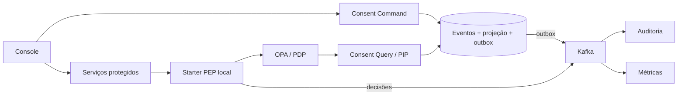

# Consent & Audit Architecture

**Quem pode usar um dado pessoal, para qual finalidade — e como investigar essa decisão depois?**

Projeto pessoal de [Renan Rohers](https://github.com/RenanRohers), iniciado no TCC, que explora controle de acesso e auditabilidade de dados pessoais em microsserviços. Esta organização reúne os componentes de uma mesma arquitetura: consentimento, identidade, políticas de autorização, eventos, auditoria e console web.

[Comece por aqui](https://github.com/consent-audit-arch/infra#readme) · [Arquitetura e diagramas](https://github.com/consent-audit-arch/infra/blob/main/docs/architecture.md) · [Executar localmente](https://github.com/consent-audit-arch/infra#executar-localmente) · [Explorar a demonstração](https://github.com/consent-audit-arch/infra/blob/main/docs/demo.md)

## O fluxo que conecta o projeto

1. Um titular concede consentimento para determinada categoria de dado e finalidade.
2. Uma requisição protegida passa pela validação de identidade e pela avaliação da política.
3. A política consulta o estado atual do consentimento para decidir sobre o acesso.
4. Após uma revogação confirmada, as novas decisões consultam a projeção atualizada.
5. As decisões registradas podem ser relacionadas ao histórico de consentimento para investigação.

## Por onde começar

| Se você quer… | Explore |
| --- | --- |
| Entender o conjunto e executar a stack | [infra](https://github.com/consent-audit-arch/infra) |
| Ver os fluxos pela interface | [consent-frontend](https://github.com/consent-audit-arch/consent-frontend) |
| Conhecer o controle reutilizável nos serviços | [tcc-security-starter](https://github.com/consent-audit-arch/tcc-security-starter) |
| Examinar Event Sourcing, projeção e outbox | [consent-command-service](https://github.com/consent-audit-arch/consent-command-service) |
| Entender as consultas usadas pelas políticas | [consent-query-service](https://github.com/consent-audit-arch/consent-query-service) |
| Investigar decisões e histórico | [audit-service](https://github.com/consent-audit-arch/audit-service) |

## Cenários e projeções

- [user-service](https://github.com/consent-audit-arch/user-service): provedor de dados pessoais fictícios e desativação de titulares.
- [billing-service](https://github.com/consent-audit-arch/billing-service): cenário de cobrança com consultas protegidas.
- [promotions-service](https://github.com/consent-audit-arch/promotions-service): promoções vinculadas a titulares e avaliação em lote.
- [dashboard-service](https://github.com/consent-audit-arch/dashboard-service): métricas de consentimento projetadas de forma assíncrona.

## Tecnologias e escolhas

**Java 21 · Spring Boot · React · TypeScript · PostgreSQL · MongoDB · Kafka · Keycloak · OPA/Rego · Docker Compose**

O comando grava eventos, projeção e outbox na mesma transação PostgreSQL. O PIP consulta essa projeção diretamente, enquanto auditoria e métricas recebem eventos de forma assíncrona. A biblioteca de segurança atua como PEP nos métodos protegidos de cada serviço, e as políticas ficam no OPA.

O protótipo aplica princípios de Zero Trust ao recorte de autorização contextual. Os registros de auditoria representam decisões de autorização; uma decisão permitida não comprova, sozinha, a conclusão da operação de negócio. A cobertura das políticas varia entre os componentes.

O objetivo é estudar mecanismos e seus custos. As garantias, limitações e próximos passos estão documentados em [Arquitetura e decisões](https://github.com/consent-audit-arch/infra/blob/main/docs/architecture.md).

---

Criado por [Renan Rohers](https://github.com/RenanRohers). Desenvolvido inicialmente como TCC e mantido como projeto pessoal.
